# Лабораторная работа № 3
## Настройка сетевой инфраструктуры AWS

**Выполнил:** Severcenco Serghei  
**Группа:** IA2404  
**Специальность:** Прикладная математика  
**Номер варианта (k):** 22 
**Уровень выполнения:** Базовый  

## Цель работы

Цель лабораторной работы — изучить основные возможности Amazon Web Services (AWS), научиться создавать виртуальную частную сеть VPC, настраивать подсети, таблицы маршрутизации, группы безопасности и сетевые ACL. Также необходимо развернуть EC2-инстансы, настроить доступ к веб-серверу и базе данных PostgreSQL, проверить сетевые соединения и организовать теги ресурсов.

## Задание 1. Адресное пространство VPC

Для проекта `timecapsule` создана виртуальная частная сеть `timecapsule-dev-vpc` с диапазоном IPv4-адресов `10.22.0.0/16`.

Внутри VPC созданы четыре подсети: две публичные и две приватные.

| Подсеть | Тип | CIDR |
|---|---|---|
| public-a | Публичная | 10.22.0.0/24 |
| public-b | Публичная | 10.22.1.0/24 |
| private-a | Приватная | 10.22.10.0/24 |
| private-b | Приватная | 10.22.11.0/24 |

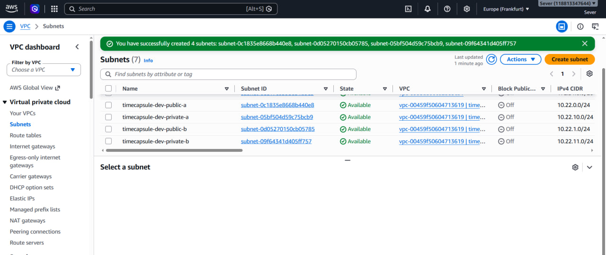

*Рисунок 1 — Созданные подсети VPC с их адресными диапазонами.*

## Задание 2. Создание EC2-инстансов

В созданной сети развернуты три виртуальных сервера Amazon EC2:

- `timecapsule-dev-bastion` — сервер для административного подключения по SSH.
- `timecapsule-dev-web` — веб-сервер с установленным Nginx.
- `timecapsule-dev-db` — сервер базы данных PostgreSQL.

Для подключения к серверам использовалась пара ключей SSH. Доступ к приватным серверам проверялся через Bastion Host.

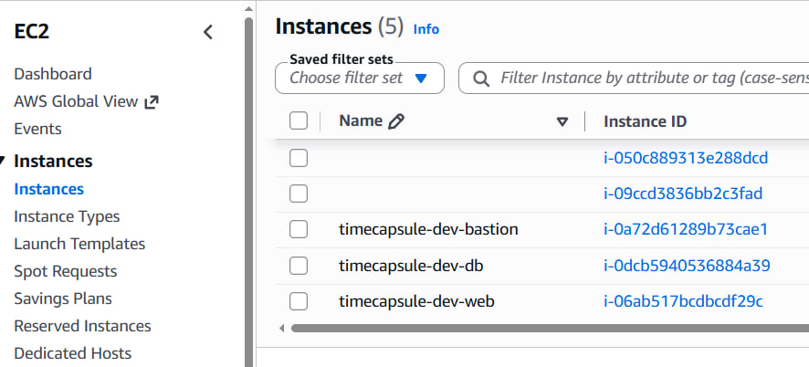

*Рисунок 2 — Список созданных EC2-инстансов.*

## Задание 3. Таблицы маршрутизации

Для управления сетевым трафиком созданы публичная таблица маршрутизации `timecapsule-dev-public-rt` и приватная таблица `timecapsule-dev-private-rt`.

Публичная таблица содержит локальный маршрут внутри VPC и маршрут `0.0.0.0/0` через Internet Gateway. Это позволяет ресурсам публичных подсетей обращаться в интернет при наличии необходимых публичных адресов и разрешающих правил безопасности.

Во время настройки NAT Gateway приватная таблица маршрутизации использовала маршрут `0.0.0.0/0` через NAT Gateway. После завершения проверки NAT Gateway был удалён, а маршрут через него удалён из приватной таблицы. Локальный маршрут `10.22.0.0/16` сохранён для связи между ресурсами VPC.

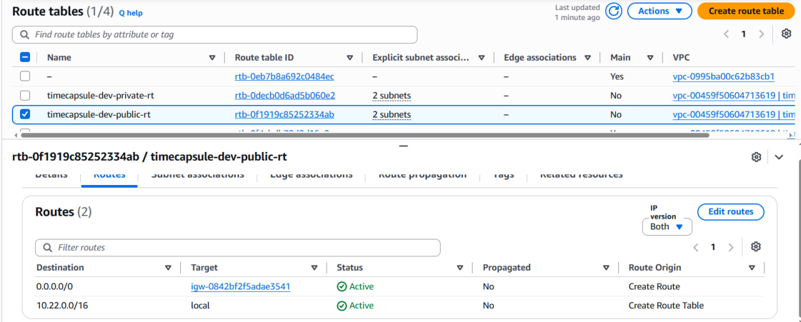

*Рисунок 3 — Маршруты публичной таблицы маршрутизации.*

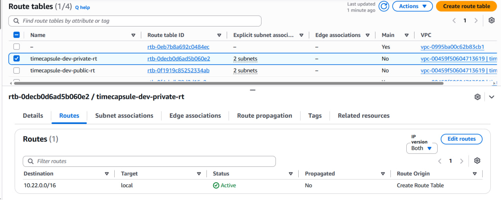

*Рисунок 4 — Маршруты приватной таблицы после удаления NAT Gateway.*

## Задание 4. Настройка Security Groups

Для управления входящими соединениями настроены группы безопасности трёх серверов.

Для Bastion разрешён доступ по SSH с определённого внешнего IP-адреса. Для Web-сервера разрешён HTTP-трафик на порт 80, а административный SSH-доступ разрешён от группы безопасности Bastion. Для DB-сервера разрешён доступ к PostgreSQL на порт 5432 от группы безопасности Web-сервера. SSH-доступ к DB-серверу также разрешён от Bastion.

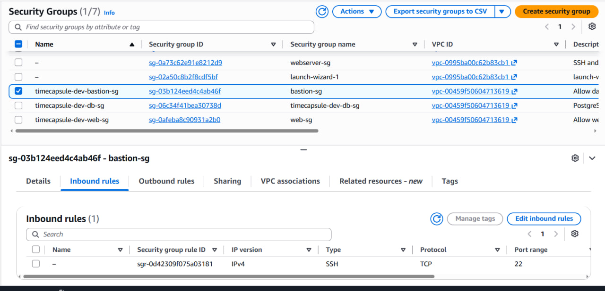

*Рисунок 5 — Входящие правила группы безопасности Bastion.*

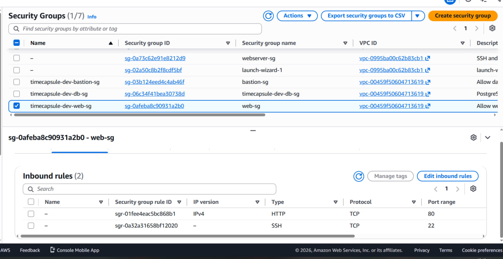

*Рисунок 6 — Входящие правила группы безопасности Web-сервера.*

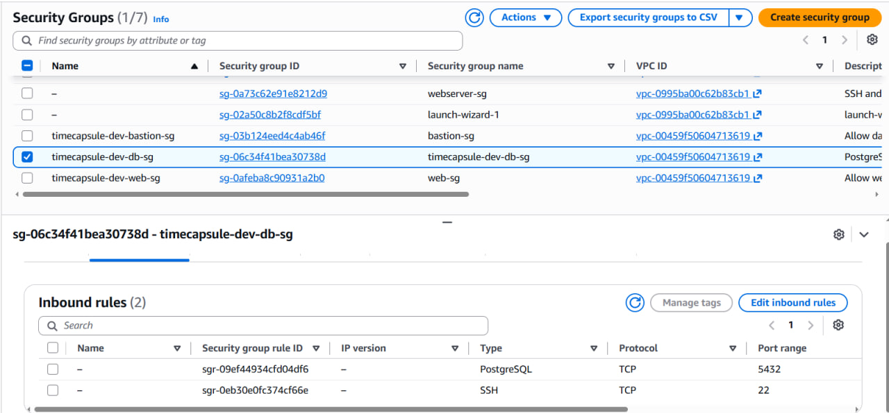

*Рисунок 7 — Входящие правила группы безопасности DB-сервера.*

## Задание 5. Проверка веб-сервера и установка PostgreSQL

На Web-сервере установлен и запущен Nginx. Доступность веб-сервера проверена через браузер по публичному IPv4-адресу.

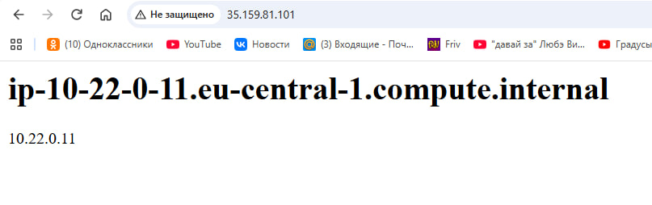

*Рисунок 8 — Открытая страница веб-сервера.*

PostgreSQL был установлен на DB-сервере после временного предоставления доступа в интернет через NAT Gateway. После установки выполнена начальная настройка PostgreSQL, создан пользователь `student` и база данных `lab3`.

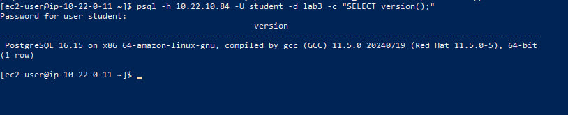

*Рисунок 9 — Установка PostgreSQL на DB-сервере. Добавить скриншот, если он был сохранён.*

## Задание 6. Настройка и удаление NAT Gateway

Для временного доступа приватного DB-сервера в интернет создан NAT Gateway `timecapsule-dev-nat-a` в публичной подсети. Для него был выделен Elastic IP, а в приватную таблицу маршрутизации добавлен маршрут `0.0.0.0/0` через NAT Gateway.

На DB-сервере выполнена команда `curl https://checkip.amazonaws.com`, которая использовалась для проверки внешнего IP-адреса при выходе через NAT. После установки необходимых компонентов и настройки PostgreSQL NAT Gateway был удалён, маршрут через него удалён, а выделенный Elastic IP освобождён.

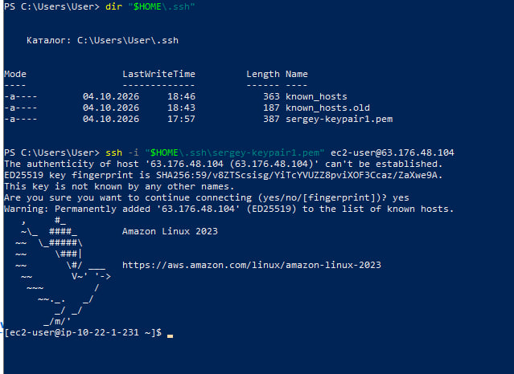

*Рисунок 10 — Результат проверки внешнего IP-адреса на DB-сервере. Добавить сохранённый скриншот.*

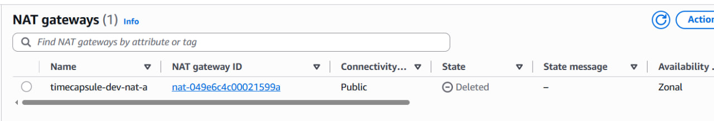

*Рисунок 11 — NAT Gateway в состоянии Deleted. Добавить скриншот, если он ещё отображается в AWS.*

##  Задание 7. Проверка сетевого взаимодействия

### Подключение к PostgreSQL

С Web-сервера выполнено подключение к базе данных `lab3`, расположенной на DB-сервере с приватным IP-адресом `10.22.10.84`. Проверка с помощью команды `SELECT version()` подтвердила возможность подключения к PostgreSQL.

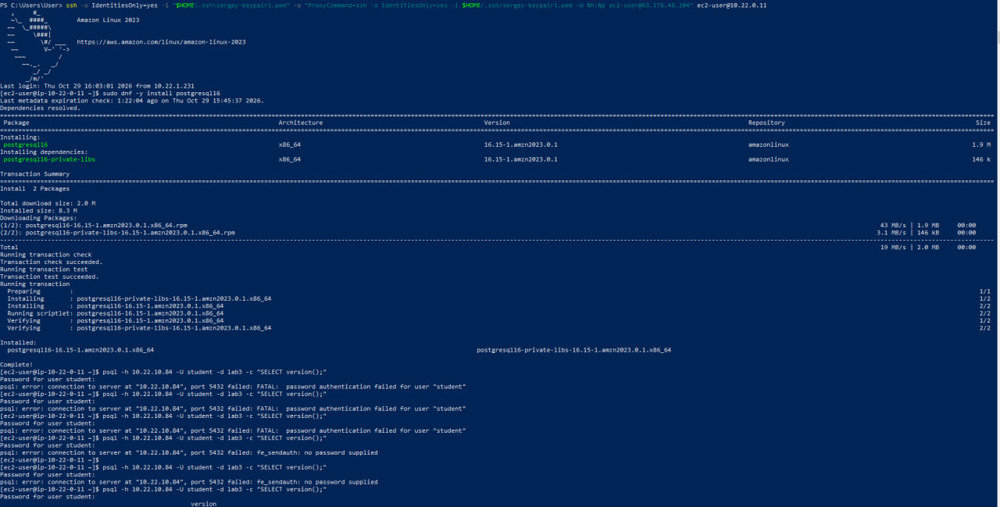

*Рисунок 13 — Проверка подключения к PostgreSQL с Web-сервера.*

### Проверка порта 5432

Для проверки доступности PostgreSQL выполнен тест TCP-подключения к порту 5432 с двух серверов.

С Web-сервера получен результат `open`, что подтверждает доступность порта. С Bastion получен результат `closed`, поскольку группа безопасности DB-сервера разрешает подключение к PostgreSQL только от группы безопасности Web-сервера.

*Рисунок 14 — Проверка TCP-порта 5432 с Web-сервера и Bastion.*

### Проверка отсутствия доступа в интернет

После удаления NAT Gateway выполнена команда `curl -m 5 https://github.com` на DB-сервере. Получен результат `Connection timed out`. Это подтверждает отсутствие доступного маршрута для исходящего интернет-соединения из приватной подсети после удаления NAT Gateway.

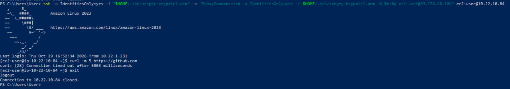

*Рисунок 15 — Результат проверки интернет-соединения с DB-сервера.*

### Проверка Network ACL

Для проверки сетевого ACL было добавлено временное запрещающее правило с номером 90 для внешнего IP-адреса клиента. Во время действия правила SSH-подключение к Bastion завершалось с ошибкой `Connection timed out`, а веб-сайт не открывался. После удаления временного правила SSH-подключение и доступ к веб-сайту восстановились.

В ходе эксперимента с Network ACL было добавлено временное
правило №90 с действием DENY для всего трафика от внешнего
IP-адреса `188.138.184.199/32`.

После применения правила SSH-подключение к Bastion
завершалось по тайм-ауту, а Web-сервер переставал открываться
из браузера.

После удаления временного правила доступ к серверам
восстановился.

### Проверка тегов ресурсов

С помощью Resource Groups & Tag Editor выполнен поиск ресурсов по тегу `Project=timecapsule`. В результате найдено 18 ресурсов. У трёх основных EC2-инстансов проверены обязательные теги `Name`, `Project`, `Environment`, `Owner` и `Lab`.

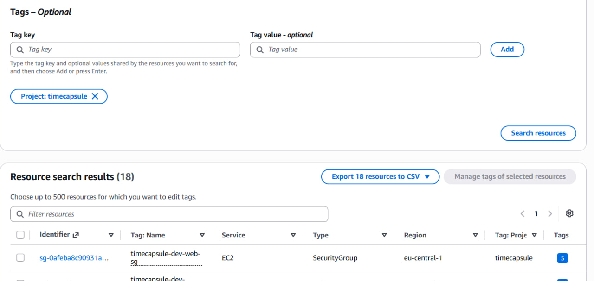

*Рисунок 17 — Результаты поиска ресурсов проекта в Tag Editor.*

## Итоговое состояние ресурсов

После завершения проверок временный NAT Gateway удалён, маршрут через NAT Gateway удалён из приватной таблицы маршрутизации, а выделенный для NAT Elastic IP освобождён. Внутренняя сеть VPC и настроенные правила доступа сохранены.

После сохранения необходимых доказательств три EC2-инстанса остановлены для сокращения расходов на вычислительные ресурсы. Диски EBS могут продолжать тарифицироваться.

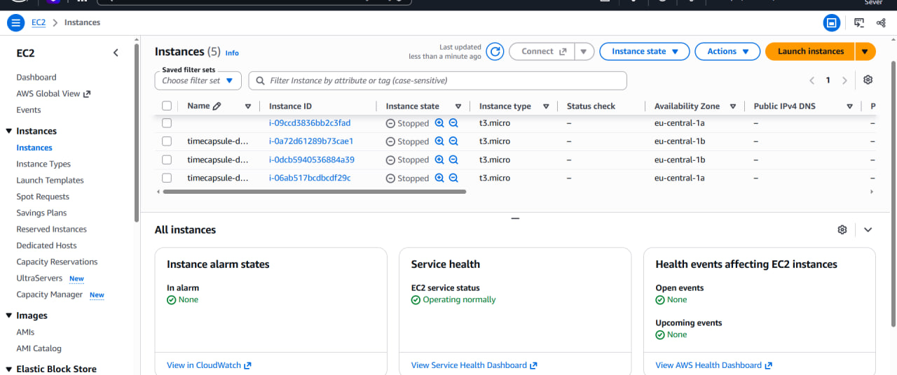

*Рисунок 18 — Три EC2-инстанса в состоянии Stopped. Добавить скриншот после остановки серверов.*

## Ответы на контрольные вопросы

### 1. Что такое VPC?

Amazon VPC — это логически изолированная виртуальная сеть в AWS, в которой можно размещать облачные ресурсы. В ней настраиваются адресные диапазоны, подсети, маршрутизация и правила сетевого доступа.

### 2. Чем отличаются публичная и приватная подсети?

Публичная подсеть связана с таблицей маршрутизации, в которой предусмотрен маршрут в интернет через Internet Gateway. Приватная подсеть не использует прямой маршрут в интернет через Internet Gateway; при необходимости исходящий доступ может предоставляться через NAT Gateway.

### 3. Для чего нужен Internet Gateway?

Internet Gateway обеспечивает связь между VPC и интернетом для ресурсов, имеющих подходящую маршрутизацию и публичные адреса. Само наличие Internet Gateway не означает, что любой ресурс автоматически становится доступен из интернета.

### 4. Для чего используется NAT Gateway?

NAT Gateway позволяет ресурсам приватных подсетей инициировать исходящие соединения с интернет-ресурсами, не предоставляя им прямого входящего доступа из интернета. В этой работе NAT Gateway временно использовался для установки PostgreSQL на DB-сервер.

### 5. Чем Security Group отличается от Network ACL?

Security Group работает на уровне сетевых интерфейсов EC2 и является stateful: разрешённый запрос автоматически допускает соответствующий ответный трафик. Network ACL применяется на уровне подсети, является stateless и проверяет входящий и исходящий трафик по правилам с номерами.

### 6. Для чего нужен Bastion Host?

Bastion Host служит промежуточным сервером для административного подключения к ресурсам в приватных подсетях. Благодаря этому нет необходимости открывать SSH-доступ к каждому приватному серверу из интернета.

### 7. Для чего используется PostgreSQL?

PostgreSQL — это система управления реляционными базами данных. В лабораторной работе на DB-сервере была создана база `lab3` и пользователь `student`, а подключение к ней проверялось с Web-сервера.

### 8. Почему после удаления NAT Gateway DB-сервер потерял доступ в интернет?

После удаления NAT Gateway и маршрута `0.0.0.0/0` приватная подсеть перестала иметь настроенный путь для исходящего соединения с интернетом. При этом локальный маршрут VPC сохранился, поэтому внутренняя связь между серверами может продолжать работать при наличии разрешающих правил безопасности.

### 9. Для чего нужны теги AWS-ресурсов?

Теги позволяют группировать, идентифицировать и учитывать облачные ресурсы. В работе использовались теги `Project`, `Environment`, `Owner`, `Lab` и `Name`, которые упрощают поиск ресурсов и контроль расходов.

### 10. Почему EC2-инстансы следует останавливать после выполнения работы?

Остановка EC2-инстансов прекращает тарификацию вычислительного времени для обычных остановленных инстансов. При этом связанные диски EBS и некоторые другие ресурсы могут продолжать тарифицироваться, поэтому необходимо отдельно проверять состояние и наличие ненужных ресурсов.

## Заключение

В ходе лабораторной работы № 3 была создана и настроена виртуальная сеть AWS с публичными и приватными подсетями. Были развернуты EC2-инстансы для Bastion, Web и DB, настроены таблицы маршрутизации и правила сетевой безопасности. На DB-сервере установлен и настроен PostgreSQL, проверено подключение к базе данных с Web-сервера, а также выполнены проверки NAT Gateway, Network ACL и тегов ресурсов. После завершения проверок временный NAT Gateway удалён, а серверы подготовлены к остановке для сокращения расходов.
